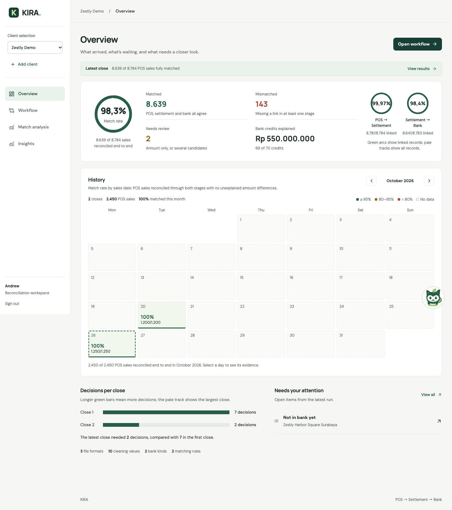
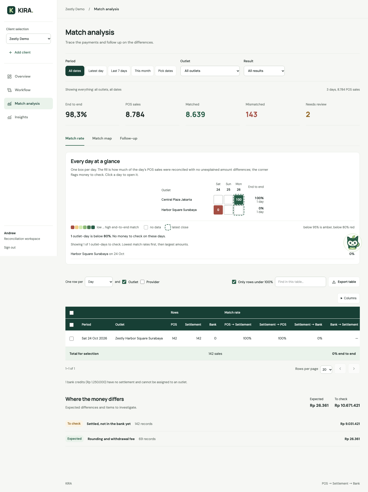
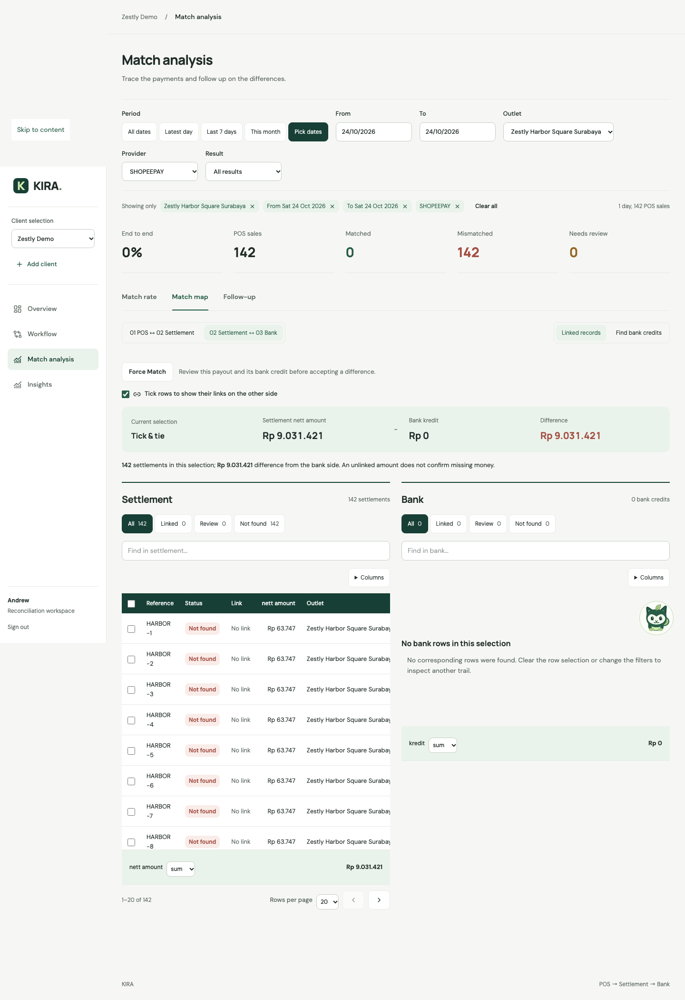

# KIRA

KIRA is a payment reconciliation workspace for Indonesian merchants. It traces POS sales through payment-provider settlements to bank credits, shows where amounts differ, and keeps the source evidence behind each result.

**[Try the live demo → kira.madgun.us](https://kira.madgun.us)**

```text
POS sales → Provider settlements → Bank credits
```

## What you can do

- Upload POS, settlement and bank reports; convert them into tables and save reusable format mappings.
- Clean outlet names, payment methods and other fields using reviewed cleaning rules.
- Suggest, create, order, activate and test matching rules before generating results in two stages.
- Inspect match rates by outlet and date, compare linked records in Match map, and track follow-ups.
- Approve an expected payout difference with Force Match, a recorded reason and an Undo action.
- Export reconciliation results to CSV or Excel.
- Use separate client workspaces, the guided tour, and the optional Kira assistant.

## Screenshots

The current `dev` UI with illustrative demo data from browser verification. Figures on the live demo depend on the selected workspace and its latest results.

**Overview** — reconciliation totals, close history and items needing attention.



<details>
<summary>Match analysis — daily match rates and money differences</summary>



</details>

<details>
<summary>Match map — settlement and bank evidence with Force Match</summary>



</details>

## Stack

| Layer | Technology |
| --- | --- |
| Frontend | React 19, TypeScript, Vite, Tailwind CSS, TanStack Table |
| API | Python 3.13, FastAPI |
| Storage | SQLAlchemy 2, SQLite database per workspace |
| Assistant | Google ADK and LiteLLM; configurable model provider |
| Verification | pytest, Vitest, Testing Library, Playwright |

## Run locally from `dev`

You need Git, Python **3.13**, `uv`, and Node.js **22** with npm.

```bash
git clone --branch dev https://github.com/taufiqrmadhana/kira.git
cd kira
```

### 1. Start the backend

For a first-time setup:

```bash
cd backend
uv sync
cp .env.example .env
```

Edit `backend/.env`. For local reconciliation without model-backed suggestions, set `KIRA_AI=off`. Leave `KIRA_PASSWORD` empty for local access without sign-in. The example's `KIRA_DATABASE_URL=sqlite:///kira.db` stores the database relative to the backend process's working directory.

Start the API from `backend/`:

```bash
uv run uvicorn kira.api.app:app --reload --host 127.0.0.1 --port 8000
```

### 2. Start the frontend

In a second terminal, from the repository root:

```bash
cd web
npm ci
npm run dev
```

| Service | Local address |
| --- | --- |
| Application | http://127.0.0.1:5173 |
| Interactive API documentation | http://127.0.0.1:8000/docs |
| Workflow status | http://127.0.0.1:8000/api/status |

Vite forwards `/api` requests to port 8000. Keep both processes running. Stop them with `Ctrl+C`.

## Configuration

Use [backend/.env.example](backend/.env.example) as the starting point. Existing shell environment variables take precedence over values loaded from `.env`.

| Variable | Purpose |
| --- | --- |
| `KIRA_DATABASE_URL` | Database URL. Use SQLite for separate client databases. |
| `KIRA_CLIENT_NAME` | Display name of the default workspace. |
| `KIRA_USER` | Default actor name used by the backend. |
| `KIRA_AI` | Enables optional AI workflow suggestions; `off` disables them. |
| `KIRA_MODEL` | Model identifier; the example uses `openai/gpt-6.1-terra`. |
| `OPENAI_API_KEY` | Credential for the configured OpenAI provider. |
| `DEEPSEEK_API_KEY` | Credential when using `KIRA_MODEL=deepseek/deepseek-chat`. |
| `KIRA_USERNAME` | Sign-in username when password authentication is enabled. |
| `KIRA_PASSWORD` | Enables sign-in when non-empty. |
| `KIRA_SECRET` | Signing secret required when password authentication is enabled. |
| `KIRA_SESSION_DAYS` | Sign-in session lifetime; defaults to 14 days. |

Manual upload, cleaning and deterministic matching do not require a model API key. Kira chat requires credentials for its configured model; `KIRA_AI=off` controls workflow suggestions, not chat access.

Keep `.env`, API keys and database files out of commits. For a shared deployment, configure both `KIRA_PASSWORD` and `KIRA_SECRET`; the empty-password setup above is for local development.

## Reconciliation workflow

1. **Upload:** choose or create a workspace, then add files to the POS, settlement and bank areas.
2. **Convert:** review detected file formats and column mappings. Save decisions for reuse on later uploads.
3. **Clean:** review and save standardization rules, including outlet-name mappings across sources.
4. **Run matching:** review and activate rules, choose which active rules to test, then generate the POS-to-settlement result followed by settlement-to-bank.

Supported uploads are UTF-8 CSV/TXT, XLSX/XLSM, and PDFs containing extractable text tables, up to **10 MB per file**. Scanned PDFs require OCR outside KIRA.

### Matching behavior

The `dev` branch retains Nurwan's matching rules and the approved deterministic handling of ambiguous POS candidates:

- Active rules run in priority order. Each later rule sees only rows left by earlier rules.
- POS matching respects the configured reference, outlet, payment method, amount and date/time conditions.
- When several settlements qualify, POS rows are processed in source order. Composite matches prefer the nearest time, then settlement source order; reference-only matches use settlement source order. Each settlement is consumed once.
- Settlement-to-bank matching supports withdrawal payouts, batches, references and amount-based review. Bank timing and amount tolerances come from the rule.
- Matching amounts and explanations remain separate: a link can still have an unexplained difference.

See [Engine rules](docs/09-engine-rules.md) for the full behavior. Changing source data or a used rule can invalidate saved results.

### Force Match

Click a **red match rate**, then use **Match map → Settlement ↔ Bank → Force Match**. Compare the payout with a possible bank credit and select the credit to review.

Approval requires a complete unlinked daily payout with one withdrawal and an unlinked same-store credit within the selected bank-arrival window. The reason card shows both amount differences and the arrival interval. Enter a reason or use the suggested text, explicitly accept the expected difference, and confirm.

Accepted payout differences remain visible under **Expected**. The saved reason, actor and time are retained, and **Undo** removes the approval. Unrelated sale-to-settlement differences keep their normal classification.

### Fresh uploads and demo data

Data is stored on the backend, so restarting the app or clearing browser cache does not reset a workspace. Identical uploaded files are detected by their content hash within that workspace. Create a new workspace to start a separate reconciliation while preserving existing data and results.

The larger demo datasets and local databases are not included in Git. The **Use sample files** control also needs sample files installed on the backend. If you have the team's seven-day demo dataset, [backend/scripts/load_demo.py](backend/scripts/load_demo.py) loads it through the API; inspect its `--help` and [data guide](docs/data-guide.md) before use. Ordinary setup does not require demo data.

## Tests and build

From `backend/`:

```bash
uv run pytest -q
```

From `web/`:

```bash
npm test
npm run build
```

The build runs TypeScript checks and writes frontend assets to `web/dist/`.

For the browser acceptance suite, keep Vite running on port 5173 and run from `web/`:

```bash
npx playwright install chromium
npm run test:browser
```

This suite uses mocked API fixtures. Screenshots are written to `web/.verification/screenshots/`. Set `KIRA_E2E_BASE` to use another local frontend address. Some backend dataset checks are skipped when optional external fixtures are absent.

## Repository layout

```text
backend/
  kira/api/        HTTP routes, authentication and progress streaming
  kira/services/   Workflow operations and persistence
  kira/core/       Parsing, matching and analysis logic
  kira/agent/      Kira assistant and tools
  tests/          Backend tests
  scripts/        Demo loading utilities
web/
  src/components/ Shared UI components
  src/pages/      Overview, workflow, analysis and insights
  src/kira/       Chat, guided tour and assistant UI
  scripts/        Browser verification scripts
docs/             Product, API, engine and team documentation
```

## Documentation and contributions

- [Product and architecture](docs/01-product-architecture.md)
- [API contract](docs/02-api-contract.md)
- [Engine rules](docs/09-engine-rules.md)
- [UI design](DESIGN.md)
- [Team assignments](docs/12-team-assignments.md)
- [Contributor and coding-agent instructions](AGENTS.md)
- [Versioned dev merge and rollback instructions](docs/dev-merge-rollback-20261107.md)

Develop on a feature branch, run the relevant checks, and review matching changes against the engine rules and source evidence before merging into `dev`. Record project work in `docs/codex-log/` as described in `AGENTS.md`.

